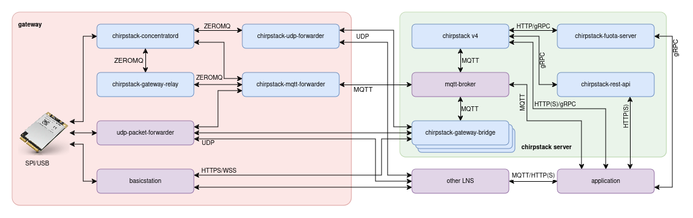

# ChirpStack Concentratord service for Docker

This is an **unofficial** build of the ChirpStack Concentratord service meant to be deployed using docker. The binaries included with this image are built from the concentratord fork at https://github.com/xoseperez/chirpstack-concentratord and may have small differences with the original binaries (check the repo for more info).

Please refer to the original sources of the project whenever possible, contribute and donate to Orne for his great work: https://github.com/chirpstack/chirpstack-concentratord

ChirpStack Concentratord is an open-source LoRa(WAN) concentrator daemon, part of the ChirpStack project. It requires other components in order to build a viable LoRaWAN solution: a chirpstack-udp-forwarder, a chirpstack-mqtt-forwarder or a chirpstack-gateway-mesh, plus an LNS such as ChirpStack.



## Tags

Each release of the fork (`v<upstream version>-r<n>`) is published as:

Tag | Points to
--- | ---
`4.7.1-r1` | that release (never changes)
`4.7.1`, `4.7`, `4`, `latest` | the newest release

Every tag is a multi-arch image for `linux/amd64`, `linux/arm64` and `linux/arm/v7`, and Docker picks the right one. The per-architecture tags (`amd64-latest`, `aarch64-latest`, `armv7hf-latest`) are no longer published.

## Chirpstack Concentratord service variables

These variables you can set them under the `environment` tag in the `docker-compose.yml` file or using an environment file (with the `env_file` tag).

Variable Name | Value | Description | Default
--- | --- | --- | ---
**`MODEL`** | `STRING` | Concentrator model, required: a concentratord model name or one of the product names below | 
**`INTERFACE`** | `SPI` or `USB` | Concentrator interface. `USB` is only supported by SX1302/3 concentrators | `USB` for USB products, `SPI` otherwise
**`LOGGING_LEVEL`** | `STRING` | One of `TRACE`, `DEBUG`, `INFO`, `WARN` or `ERROR` | `INFO`
**`REGION`** | `STRING` | Region: `as923`, `as923_2`, `as923_3`, `as923_4`, `au915`, `cn470`, `eu433`, `eu868`, `in865`, `kr920`, `ru864` or `us915` (2.4 GHz concentrators always use `ism2400`) | `eu868`
**`CHANNELS`** | `STRING` | Channel plan, for regions with several: `us915_0` to `us915_7`, `au915_0` to `au915_7`, `cn470_0` to `cn470_11` | the region's first plan
**`GATEWAY_EUI`** | `STRING` | Gateway EUI, 16 hex characters. SX1302/3 and 2.4 GHz concentrators report their own, which this overrides | for SX1301, derived from a MAC address (see below)
**`GATEWAY_EUI_SOURCE`** | `STRING` | SX1301 only: network interface whose MAC address gives the gateway EUI | the first of `eth0`, `wlan0`, `usb0` and `eth1`
**`HAS_GPS`** | `0` or `1` | Set if the concentrator has a built-in GPS | `1` for the products with one, `0` otherwise
**`RESET_GPIO`** | `INT` | Reset GPIO. For SPI concentrators, concentratord resets through it; for USB ones, the image resets through it before starting (a comma-separated list is allowed) | SPI: the model's default; USB: none
**`RESET_ACTIVE`** | `0` or `1` | USB only: level that holds the concentrator in reset | `1`
**`POWER_EN_GPIO`** | `INT` | Power-enable GPIO. For SX1302/3 SPI concentrators, concentratord drives it; for USB ones, the image does before starting | none
**`POWER_EN_LOGIC`** | `0` or `1` | USB only: level that powers the concentrator | `1`
**`GPIO_CHIP`** | `STRING` | GPIO chip of the reset and power-enable lines, such as `gpiochip0`. For SPI concentrators it is only passed on when set | the model's default for SPI; for USB, `gpiochip0` (`gpiochip4` on a Raspberry Pi 5)
**`USE_LIBGPIOD`** | `0` or `1` | USB only: drive the GPIOs with libgpiod (needs the `/dev/gpiochipN` device) instead of sysfs (needs `/sys/class/gpio`, so in practice a privileged container) | `1` on a Raspberry Pi 5, `0` otherwise
**`SOCKET_NAME`** | `STRING` | IPC socket prefix used by the other services to talk to this one | `concentratord`

`DEBUG` still works as the old name of `LOGGING_LEVEL`, with a warning in the log.

### Gateway EUI

The SX1301 has no EUI of its own, so the image derives one from the MAC address of a network interface. Without `network_mode: host`, that interface is the container's own, whose MAC address can change when the container is recreated, and the EUI with it; the log warns when this is the case. Set `GATEWAY_EUI`, or use `network_mode: host`.

SX1302/3 and 2.4 GHz concentrators report their own EUI. Once the service runs, `docker exec <container> gateway_eui` prints it.

To see the configuration a set of variables produces, without starting the service:

```sh
docker run --rm -e MODEL=RAK2287 -e REGION=US915 xoseperez/chirpstack-concentratord bash start --render
```

## Use

Check the included `docker-compose.yml` file for a usage example. The image runs as user `nobody` and needs no privileges: give it the concentrator's device (`/dev/spidev0.0`, `/dev/ttyACM0`, ...) and the GPIO chip with `devices`, and the groups that may use them with `group_add`.

## Supported models

`MODEL` takes any model the concentratord binaries of the release support; the image reads the list from their source when it is built, and an unknown `MODEL` makes the log list them all. In 4.7.1:

* SX1301: `imst_ic880a`, `kerlink_ifemtocell`, `multitech_mtac_lora_h_868`, `multitech_mtac_lora_h_915`, `multitech_mtcap_lora_868`, `multitech_mtcap_lora_915`, `pi_supply_lora_gateway_hat`, `rak_2245`, `rak_2246`, `rak_2247`, `risinghf_rhf0m301`, `sandbox_lorago_port`, `wifx_lorix_one`
* SX1302/3: `dragino_pg1302`, `elecrow_lr1302`, `embit_emb_lr1302_mpcie`, `miromico_gwc_02_lw_868`, `miromico_gwc_02_lw_915`, `multitech_mtac_003e00`, `multitech_mtac_003u00`, `multitech_mtcap3_003e00`, `multitech_mtcap3_003u00`, `rak_2287`, `rak_5146`, `seeed_wm1302`, `semtech_sx1302c490gw1`, `semtech_sx1302c868gw1`, `semtech_sx1302c915gw1`, `semtech_sx1302css868gw1`, `semtech_sx1302css915gw1`, `semtech_sx1302css923gw1`, `waveshare_sx1302_lorawan_gateway_hat`
* SX1280 (2.4 GHz): `multitech_mtac_lora_2g4`, `rak_5148`, `semtech_sx1280z3dsfgw1`

Product and chip names also accepted: `RAK831`, `RAK833`, `RAK2245`, `RAK2246`, `RAK2247`, `RAK7243`, `RAK7243C`, `RAK7244`, `RAK7244C`, `RAK7246`, `RAK7246G` (SX1301); `RAK2287`, `RAK5146`, `RAK7248`, `RAK7248C`, `RAK7271`, `RAK7371`, `WM1302` (SX1302/3); `RAK5148`, `SX1280ZXXXXGW1` (SX1280); `IC880A`; and the generic `SX1301`, `SX1302`, `SX1303` and `SX1280`.

## Building

The image packages the release tarballs of the fork, plus the region and channel files of each concentrator design; it compiles nothing. From the root of the repository:

```sh
# Get the binaries: build them, or download the tarballs of a release
make dist-x86_64-unknown-linux-musl
# gh release download v4.7.1-r1 --pattern 'chirpstack-*.tar.gz' --dir dist

docker buildx bake -f docker/docker-bake.hcl --load --set '*.platform=linux/amd64'
```

`dist/` must hold exactly one tarball per design and architecture being built; `--set '*.contexts.dist=<folder>'` takes them from another folder (outside the repository, also pass `--allow=fs.read=<folder>`). Set `REGISTRY` and `VERSION` to name the image differently, and use `--push` instead of `--load` to push it.

Releases are built, tested and pushed to Docker Hub by `.github/workflows/docker-release.yml`, when a fork release is published or when the workflow is run by hand.

## License

ChirpStack Concentratord is distributed under the MIT license (and so is this repository). See LICENSE.
